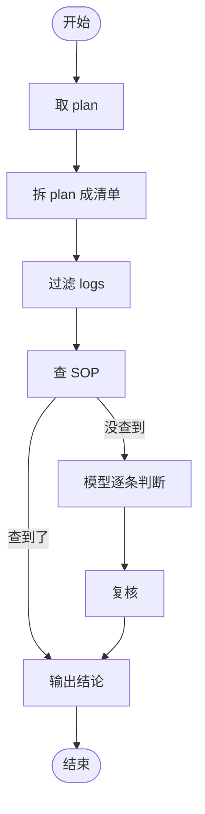

# PCR Agent 项目讨论总结

> 给 Claude Code 看的项目背景和改造要求。最后更新：2026-11-09
>
> 全文按三个部分组织：**一、Agent Loop，二、Tools，三、Evaluation**。

## 背景（先读这段）

- **目标**：审计 ITSM 里的 Change Request（CR），检查 CR 申明的 implementation plan 和工程师实际在设备上执行的命令日志是否匹配。CR 说做 A，实际执行的是做 B，就是 unauthorized change，要抓出来。
- **输入**：一个 CR 号。**输出**：是否 unauthorized、依据是什么、问题出在哪、为什么。
- **现状**：已经有一个完整项目在跑，只是用 one shot prompt：一次把 plan + logs + SOP 全塞给模型，一次返回结果，**false positive 很高**。
- **改造范围**：平台、API、数据库、Data Collector、前台都已经有了，**只改 Agent 层，不要动它们**。保留现有的 one shot 版本当兜底，新版本先并行跑，对比后再切换。
- **数据流**：ITSM / Graylog / SOP -> Data Collector 服务 -> 数据库；数据库 -> 平台后端 API -> 前台（显示 CR 信息、log 信息）；数据库 -> Agent 工具 -> LangGraph 循环 -> 判断结论。前台要显示 CR 和 log 信息，所以数据必须存数据库，不能现拉不存；前台和 Agent 读同一份存量数据，避免显示和判断不一致。Collector 触发：CR 创建时 / 平台点刷新按钮时重新拉取；SOP 可按计划（例如每天）同步。
- **模型**：公司提供模型，通过公司 LiteLLM API 调用，背后是 **GLM 5.3 Flash**，走 Chat Completions 接口。
- **判断标准**：write（改了任何东西），且 plan 里没申明、SOP 也没 cover = unauthorized；只读命令如 `show` 永远没事，因为没改任何东西；SOP 是例外 / allowlist，plan 里没有的东西如果 SOP 能 cover 就没事，输出要引用 SOP 编号（例如 SOP123）并引用原文。
- **约束**：同一份代码要在本地和 Linux server 上都能跑，环境相关的值（LiteLLM 地址、密钥、Graylog / ITSM 地址、DB 地址）全部放环境变量，不要硬编码；安装只能用 pip / npm，不能自己去网站下载东西；公司电脑不能上外网，公司 npm 可以下载部分 JS 包；已安装 LangGraph、LiteLLM、SQLAlchemy + DB 驱动、FastAPI + Uvicorn、Pydantic、python-dotenv、pytest；DB 用 Postgres 还是 MySQL 待确认，驱动对应是 psycopg2-binary 或 pymysql。

---

## 一、Agent Loop

### 1.1 Loop 是什么

Agent Loop 就是 ReAct（Reason + Act）的工程实现：想一步 -> 调工具 -> 看结果 -> 再想下一步，循环直到得出结论。不要手写这个循环，**用 LangGraph 直接做**，它提供循环、步骤间传状态、分支、检查点、人工复核关卡、重试和日志。

### 1.2 图长什么样

节点：取 plan -> 拆 plan -> 过滤 logs -> 查 SOP -> 逐条判断 -> 复核 -> 输出



- 节点 = 一个步骤 / 函数；边 = 箭头，“做完 A 做 B”；条件边 = 判断菱形，例如查到 SOP 走输出分支，没查到走判断分支。
- 图是代码写出来的、可执行的流程图，不是静态图，调 `graph.invoke()` 就真的跑起来。
- 扩展时只加节点 + 一两条边，例如判断后加人工复核节点，输出后加通知节点，其他节点不动。

### 1.3 每一步干什么

1. **取 plan**：按 CR 号从 DB 取 plan 原文。Plan 是 CR 里的 free-text 字段，说明要做什么，有时包含实际命令，不是结构化数据。
2. **拆 plan**：模型把 plan 拆成结构化清单：设备、动作、如果有写明的命令也列出来。
3. **过滤 logs**：**用代码批量处理，不要用模型逐条看**。过滤时间窗口、去重、划掉只读命令、原文对上的直接通过。一个 CR 约 100 条日志，大部分在这里解决。
4. **查 SOP**：对剩下的未匹配 write 命令查 SOP。
5. **逐条判断**：模型只判断剩下的未匹配 write 命令，分批处理（例如每次约 10 条），带着 plan 清单 + SOP 结果。按设备 + 时间 + 会话分组，一个配置会话不要算成多个 unauthorized。
6. **复核**：每条 unauthorized 必须能引用真实 log 记录和一次失败的 SOP 查询，否则降级为 needs-review。这是降低 false positive 最直接的一步。
7. **输出**：固定 JSON，见下。

### 1.4 Function calling 怎么走

- 传 `tools` 就能做 function calling；模型自己决定调不调、调哪个、传什么参数。不要一次传所有工具，只传当前步骤需要的工具。当前工具只有 3 个，全传也可以。
- 模型返回 `finish_reason: "tool_calls"` 时，Agent 代码执行真实函数，再把结果以 `role: "tool"` 的消息喂回模型，继续循环，直到返回 `finish_reason: "stop"` 的纯文本结论。
- 模型本身不执行任何东西，只返回要调哪个工具和参数；执行是 Agent 代码做的。
- MCP 和 A2A 的位置：MCP 是 Agent 调工具的协议；A2A 是 Agent 调 Agent 的协议，一个 Agent 把任务交给另一个专家 Agent。工具是单一技能，Agent 是把技能、知识、规则包在一起的专家，能独立完成一整类任务。v1 不需要 A2A，先把单 Agent + 直接工具做稳。

### 1.5 规则分层（不要全塞进一个 prompt）

One shot 失败的原因就是这四层全混在一个 prompt 里，上下文一大模型就丢规则。分开：

1. **代码**：只读过滤、时间窗口、去重、原文精确匹配。
2. **系统提示词**：核心判断标准，短而稳定：写命令必须有出处（plan 或 SOP）；每判一条 unauthorized 必须引用具体 log 记录，否则降级为 needs-review。
3. **配置文件 / skill 文件**：可变规则，例如各厂商 write 命令动词清单、SOP 索引、团队约定。
4. **当次任务数据**：这个 CR 的 plan、logs、相关 SOP 摘要。

### 1.6 输出格式（固定 JSON，不要只返回一段话）

```json
{
  "verdict": "unauthorized",
  "unauthorized_commands": [
    {"command": "...", "log_id": "...", "device": "...", "reason": "..."}
  ],
  "sop_covered": [
    {"command": "...", "sop_id": "SOP123"}
  ],
  "needs_review": []
}
```

- verdict 取值：authorized / unauthorized / needs-review。

---

## 二、Tools

### 2.1 工具的定位

- **数据在数据库里，Agent 循环用 LangGraph，工具是 SQLAlchemy ORM 函数去 DB 取数据**。
- 工具是确定性的单步操作：输入固定，输出固定，不做判断、不做决定，只负责把一件事做完。判断是 Agent Loop 的活，不是工具的活。
- 工具只读数据库，LLM 只给参数（如 cr_number、关键词），**绝不让 LLM 写自由 SQL**。
- 工具返回 dict / JSON，不要返回原始 ORM 对象。

### 2.2 三个工具

| 工具 | 输入 | 输出 | 说明 |
| --- | --- | --- | --- |
| 取 plan | cr_number | plan 原文 | 从 DB 的 CR 表取 |
| 取 logs | cr_number / 时间窗口 | log 记录列表 | 每条记录：谁、在哪台设备、用什么 ID、什么时间、执行了什么命令；Graylog 数据已由 Collector 存进 DB |
| 查 SOP | 关键词 / 命令 | SOP 文档列表 | 返回 SOP 编号 + 原文摘要，供判断时引用 |

- 工具定义用 JSON Schema，描述要写清楚，模型靠描述决定调哪个工具。描述质量决定模型会不会调错工具。
- 一个 LangGraph 节点可以调一个或多个工具。

### 2.3 工具和 Loop 的关系

```
你的 CR 审计 Agent（Loop，LangGraph）
    ↓ 内部调工具
工具：取 plan、取 logs、查 SOP（SQLAlchemy ORM 函数）
    ↓
数据库（Collector 已写入）
```

- 什么时候做成工具：一步就能做完、不用判断的事，例如查 SOP、取 logs。
- 什么时候做成 Agent：要多步、要判断、要综合好几个结果才能下结论的事，例如判断 unauthorized。
- 你的项目两者都要：取数那部分是工具，判断那部分是 Agent，缺一个都不行。

---

## 三、Evaluation

### 3.1 先分清两个错误

- **false positive（误报）**：没问题，却报了。现在的主要问题，浪费人力、损害信任。
- **false negative（漏报）**：真有问题，却漏掉了、放行了。**更严重**，真的 unauthorized change 逃出去了。

### 3.2 测试集和混淆矩阵

用人工标注过的历史 CR 当测试集，跑完 Agent 填这个表：

- TP：真有问题，报出来了。
- FP：没问题，误报了。
- FN：真有问题，漏掉了。
- TN：没问题，放行了。

### 3.3 三个指标（按优先级）

- **Recall = TP / (TP + FN)，第一优先级**：真问题抓到多少。
- **Precision = TP / (TP + FP)**：报出来的有多少是真的，低就是现在的 false positive 问题。
- **F1 = 2 x Precision x Recall / (Precision + Recall)**：单个对比数字，用来比较 one shot 和 agentic 两个版本。
- **Accuracy = (TP + TN) / 总数，不能当主指标**：100 个 CR 里只有 5 个真问题，什么都不报也能得 95% 准确率，Recall 是 0。

### 3.4 怎么跑评估

1. 准备约 10 个已人工判过的历史 CR，先从小样本开始。
2. one shot 版和 agentic 版跑同一批 CR，填各自的混淆矩阵，算 Recall / Precision / F1。
3. 每次改规则 / prompt / 流程后都要重跑，**先确认 Recall 没掉，再庆祝 Precision 上升**。
4. 确认 agentic 版确实更好再切换，one shot 留着当兜底。

---

## 给 CC 的改造步骤

1. 先读现有的 one shot 代码，总结输入、输出格式和 prompt 拼法，给出改造方案，等确认后再动手。
2. 按“一、Agent Loop”搭 LangGraph 图，一次只改一个节点，改完跑通再改下一个。
3. 按“二、Tools”把数据从 prompt 里移出来，放到三个 SQLAlchemy ORM 工具里；把规则按 1.5 节分层。
4. 输出改成 1.6 节的固定 JSON，加上复核节点。
5. 按“三、Evaluation”用历史 CR 跑评估，对比 one shot，确认变好再切换。
